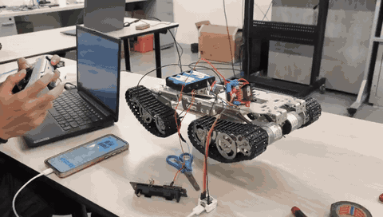

# Optimus
Optimus is a tracked autonomous mini vehicle. A **LilyGO T-Beam v1** (ESP32) drives two 12V DC motors through an **L298N** and reads an **HC-SR04** sonar and an **HDC1080** temperature/humidity sensor. An Android phone running a modified **[OpenBot](https://github.com/ob-f/OpenBot)** app is the brain: it drives the robot (gamepad or AI modes such as person following), streams its camera, and uploads the sensor readings with GPS to a **FIWARE** backend with a live web dashboard.

- **How it all fits together:** [architecture guide](docs/ARCHITECTURE.md), with diagrams.
- **Parts, wiring and pinout:** [hardware components guide](docs/hardware-components.md).

<p align="center">
  
  <br>
  <em>Optimus tracks driven from a phone running OpenBot (<a href="docs/media/working.mp4">full video</a>).</em>
</p>

## Quick start (OpenBot)

### Requirements

- **Hardware:** LilyGO T-Beam v1 (AXP2101), L298N motor driver with the ENA/ENB jumpers on, 12V battery, two DC motors, HC-SR04 with a 5V → 3.3V divider on ECHO, HDC1080, Android phone and a USB OTG **data** cable, optional Bluetooth gamepad (PS4, PS5 or Xbox).
- **Software:** [PlatformIO](https://platformio.org/install/cli) and Git on your laptop, and Android Studio to build the app in [`android/`](android/).

### Run it

1. **Wire it** following the [pinout](docs/hardware-components.md#3-general-pinout-map-for-firmware-configuration): left track on GPIO `25`/`4`, right track on `13`/`2`, sonar TRIG/ECHO on `14`/`39`, HDC1080 on I2C `21`/`22`. The pins live in [`include/config/`](include/config/). Tie the T-Beam, L298N and HC-SR04 grounds together.
2. **Flash the T-Beam** while it is plugged into your laptop:
   ```bash
   git clone https://github.com/rosvend/optimus.git && cd optimus
   pio run -e tbeam -t upload
   ```
3. **Install the app:** uninstall the Play Store OpenBot first (same `applicationId`), then build and install from `android/` (`./gradlew :robot:assembleDebug`). See [android/UPSTREAM.md](android/UPSTREAM.md) for what changed from upstream OpenBot.
4. **Connect the phone** to the T-Beam with the OTG cable and allow the USB permission prompt.
5. **Open the app** and tap the USB icon. The baud rate should be `115200` and the robot type `OPTIMUS`. *Robot Info* shows the sonar distance, temperature and humidity.
6. **Drive:** pair your gamepad over Bluetooth, set the control mode to *Gamepad* and the drive mode to *Game* (R2 forward, L2 reverse, left stick steers). Start in *Slow* speed mode.
7. **Go autonomous:** pick an AI mode in the app, such as person following.

> **Safety:** speed changes are ramped and the tracks pause at zero before reversing, so a full direction flip takes about 3.5 s. The motors stop if the phone stops sending heartbeats (for example, if the cable is unplugged). Keep the tracks off the ground for your first tests.

### Other commands

```bash
pio test -e native                    # run the firmware unit tests on your laptop
pio run -e tbeam_keyboard -t upload   # bench test: w/s/a/d over the serial monitor, space, x or the button stop
pio device monitor -e tbeam           # serial monitor at 115200
```

## Telemetry, dashboard and video

Sensor readings (temperature, humidity, GPS) go to a FIWARE stack (Orion, QuantumLeap, CrateDB, Grafana) behind a small Flask microservice, all run with Docker Compose. See the [FIWARE guide](fiware/README.md) for deployment and the API.

The Android app is the uploader: it parses the `e<temperature>,<humidity>` serial lines from the board, tags them with the phone GPS position, and POSTs batches to the microservice every 15 s. The microservice also serves the live [dashboard](dashboard/README.md), which shows the latest readings, a chart per sensor, the robot's trail on a campus map and the phone camera over WebRTC.
