# Arquitectura de Optimus

Optimus es un vehículo de orugas autónomo. Este documento describe cómo está construido y cómo funciona: qué hace cada parte, cómo se comunican entre sí y por dónde viajan los datos, desde los motores hasta el dashboard web.

## Contenido

1. [Visión general](#1-visión-general)
2. [Hardware](#2-hardware)
3. [Firmware del T-Beam](#3-firmware-del-t-beam)
4. [Protocolo serial T-Beam ↔ app](#4-protocolo-serial-t-beam--app)
5. [App Android (OpenBot modificada)](#5-app-android-openbot-modificada)
6. [Backend FIWARE](#6-backend-fiware)
7. [Dashboard web](#7-dashboard-web)
8. [Streaming de video (WebRTC)](#8-streaming-de-video-webrtc)
9. [Mecanismos de seguridad](#9-mecanismos-de-seguridad)
10. [Despliegue y pruebas](#10-despliegue-y-pruebas)
11. [Estructura del repositorio](#11-estructura-del-repositorio)

---

## 1. Visión general

El sistema tiene tres capas:

- **Robot (borde):** una **LilyGO T-Beam v1** (ESP32) mueve los dos motores a través de un **L298N** y lee un sonar **HC-SR04** y un sensor de temperatura y humedad **HDC1080**.
- **Cerebro (celular):** un Android con la **app OpenBot modificada** va montado en el robot y conectado al T-Beam por USB OTG. Decide cómo moverse (gamepad, modo autónomo con detección de personas o control web), aporta la cámara y el GPS, y sube la telemetría a la nube.
- **Nube:** un stack **FIWARE** en Docker Compose (Orion, QuantumLeap, CrateDB, Grafana) detrás de un microservicio **Flask**, que además sirve el **dashboard web** y hace de servidor de señalización WebRTC para ver la cámara del robot.

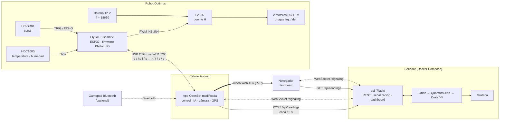

| Capa | Tecnología | Carpeta |
|---|---|---|
| Firmware | C++ / Arduino sobre PlatformIO, tests con Unity | `src/`, `lib/`, `include/`, `test/` |
| App | Java (fork de [OpenBot](https://github.com/ob-f/OpenBot), commit `0aac230`) | `android/` |
| Backend | Python 3.13, Flask + flask-sock, gunicorn, FIWARE | `fiware/` |
| Dashboard | TypeScript + Vite | `dashboard/` |
| Mecánica | Soporte del celular (STEP / STL) | `docs/cad/` |

---

## 2. Hardware

La especificación completa está en [hardware-components.md](hardware-components.md) y las hojas de datos en `docs/datasheets/`.

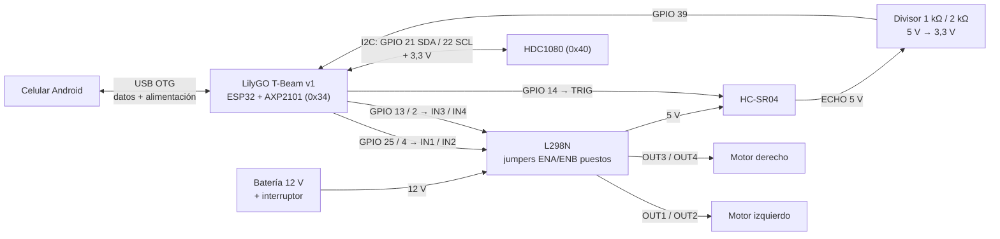

| Señal | GPIO | Nota |
|---|---|---|
| Oruga izquierda IN1 / IN2 | 25 / 4 | PWM; adelante = PWM en IN1, atrás = PWM en IN2 |
| Oruga derecha IN3 / IN4 | 13 / 2 | PWM; GPIO 2 arranca en bajo, así los motores quedan quietos al encender |
| HC-SR04 TRIG / ECHO | 14 / 39 | ECHO pasa por un divisor de 5 V a 3,3 V |
| HDC1080 SDA / SCL | 21 / 22 | Bus I2C compartido con la PMU AXP2101 |
| Botón de usuario | 38 | Parada en el firmware de banco (`tbeam_keyboard`) |

Reglas de energía y cableado:

- El **celular alimenta al T-Beam** por el cable OTG; la **batería de 12 V alimenta al L298N** y los motores.
- El HC-SR04 toma 5 V de la salida del L298N. **Las tierras del T-Beam, el L298N y el HC-SR04 van unidas.**
- No se usan los GPIO 32/33 porque en el T-Beam v1.x van a la radio LoRa. LoRa, GPS y OLED del T-Beam no se inicializan (el GPS lo pone el celular).
- Los pines y tiempos viven en `include/config/*.h`.

---

## 3. Firmware del T-Beam

### 3.1 Entornos de PlatformIO

| Entorno | Fuente | Uso |
|---|---|---|
| `tbeam` | `src/openbot/` | Firmware de producción, habla con la app OpenBot |
| `tbeam_keyboard` | `src/keyboard/` | Pruebas de banco: `w`/`s`/`a`/`d` por el monitor serial; espacio, `x` o el botón detienen |
| `native` | — | Compila `lib/` en el PC y corre los tests Unity |

### 3.2 Capas

La lógica que no depende del hardware vive en librerías de `lib/` que **no incluyen `<Arduino.h>`** (salvo `motor`), así compilan tanto para el ESP32 como para el PC y se prueban sin la placa. `src/openbot/main.cpp` es una capa delgada que solo une esas librerías con los periféricos.

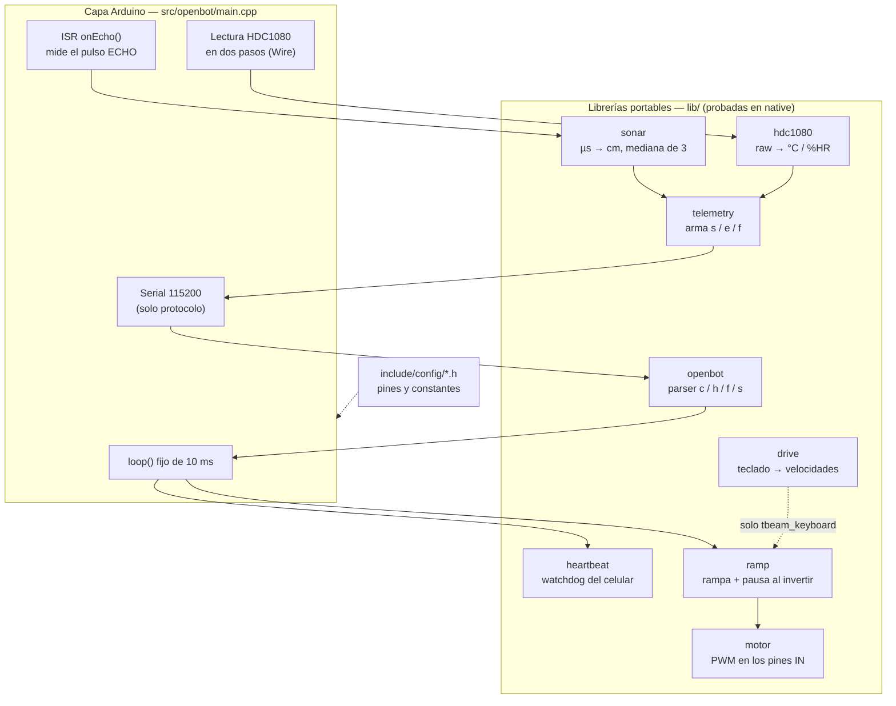

### 3.3 Ciclo principal

El loop nunca se bloquea: el sonar se mide con una interrupción y el HDC1080 con una máquina de estados de dos pasos, así el watchdog y las rampas se actualizan siempre cada 10 ms.

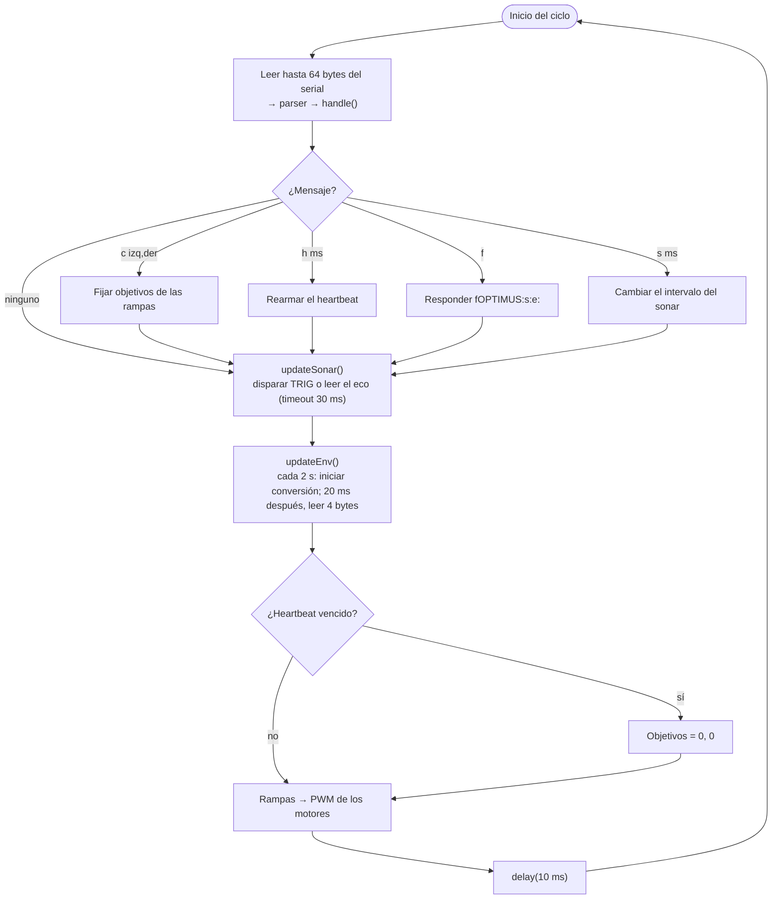

Parámetros principales:

| Parámetro | Valor | Archivo |
|---|---|---|
| Periodo del loop | 10 ms | `controls_config.h` |
| Aceleración máxima | 170 unidades PWM/s | `ramp_config.h` |
| Pausa en cero antes de invertir | 500 ms | `ramp_config.h` |
| Intervalo del sonar | 100 ms (la app puede cambiarlo) | `sensors_config.h` |
| Timeout del eco | 30 ms → se reporta 300 cm | `sensors_config.h` |
| Intervalo del HDC1080 | 2000 ms | `sensors_config.h` |
| Bytes de serial por ciclo | 64 como máximo | `openbot_config.h` |

---

## 4. Protocolo serial T-Beam ↔ app

Líneas de texto terminadas en `\n`, a 115200 baudios. En el entorno `tbeam` **el puerto serial es exclusivo del protocolo**: cualquier línea de depuración que empiece con `s`, `f`, `v`… la app la interpretaría como dato.

| Dirección | Mensaje | Ejemplo | Significado |
|---|---|---|---|
| App → T-Beam | `c<izq>,<der>` | `c120,-120` | Velocidad de cada oruga, −255..255 |
| App → T-Beam | `h<ms>` | `h750` | Heartbeat: si no llega otro en `<ms>`, el robot se detiene |
| App → T-Beam | `f` | `f` | Pide las capacidades del robot |
| App → T-Beam | `s<ms>` | `s100` | Intervalo de medición del sonar |
| T-Beam → App | `r` | `r` | Listo (al arrancar) |
| T-Beam → App | `f<tipo>:<features>` | `fOPTIMUS:s:e:` | Tipo de robot; `s` = sonar, `e` = sensor ambiental (propio de Optimus) |
| T-Beam → App | `s<cm>` | `s42` | Distancia en cm (mediana de 3); 300 = sin obstáculo |
| T-Beam → App | `e<°C>,<%HR>` | `e23.4,61.2` | Temperatura y humedad con un decimal (mensaje nuevo de Optimus) |

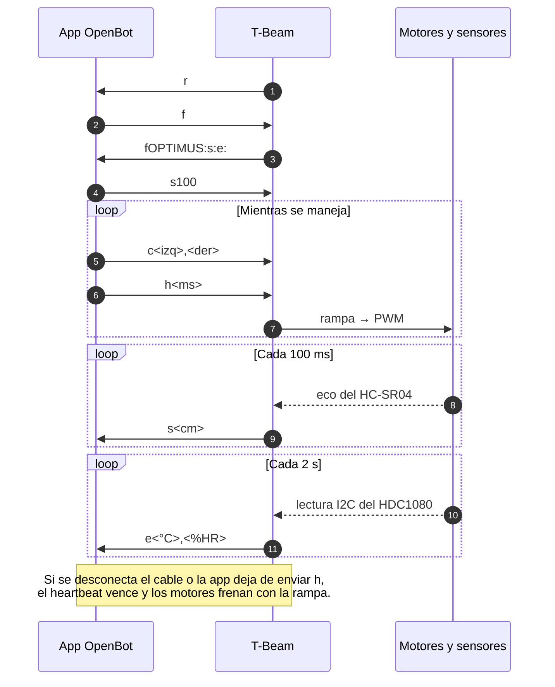

Agregar un mensaje nuevo implica tocar los dos lados: `lib/telemetry` (y la cadena de features) en el firmware, y `Vehicle.java` / `ControlsFragment.java` en la app.

---

## 5. App Android (OpenBot modificada)

Es una copia de `android/` de OpenBot (licencia MIT) con cambios propios registrados en [android/UPSTREAM.md](../android/UPSTREAM.md). La app conserva todo lo de OpenBot (control por gamepad, modos de IA como seguimiento de personas, controlador web) y agrega:

| Cambio | Archivos principales |
|---|---|
| Lee el mensaje `e` y la feature `:e:` | `vehicle/Vehicle.java`, `common/ControlsFragment.java` |
| Muestra temperatura y humedad en *Robot Info* | `robot/RobotInfoFragment.java`, `fragment_robot_info.xml` |
| Sube telemetría al backend FIWARE | `telemetry/` (`TelemetryManager`, `TelemetryStore`, `TelemetryClient`, `LiveLocation`) |
| Comparte la cámara entre el detector y el stream WebRTC | `env/SharedCameraCapturer.java`, `common/CameraFragment.java`, `env/WebRtcServer.java` |
| Dibuja las cajas de las personas detectadas sobre el stream | `objectNav/ObjectNavFragment.java`, `tracking/MultiBoxTracker.java` |
| El modo Web conecta con la señalización propia y no se cae cuando el navegador se va | `ControlsFragment.java`, `FreeRoamFragment.java`, `LoggerFragment.java` |

### Subida de telemetría

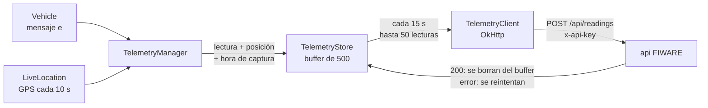

Cada lectura viaja con `age_ms` (hace cuánto se tomó). El servidor le pone la hora `ahora − age_ms`, así las lecturas que se guardaron sin conexión conservan su hora real sin que el T-Beam necesite reloj. La URL y la API key se configuran en *Ajustes → Cloud Telemetry* (con valores por defecto desde `telemetry.properties`).

---

## 6. Backend FIWARE

Todo corre con `docker compose` desde `fiware/`. Solo `api` y Grafana se exponen; Orion, QuantumLeap y CrateDB escuchan en `127.0.0.1` porque no tienen autenticación.

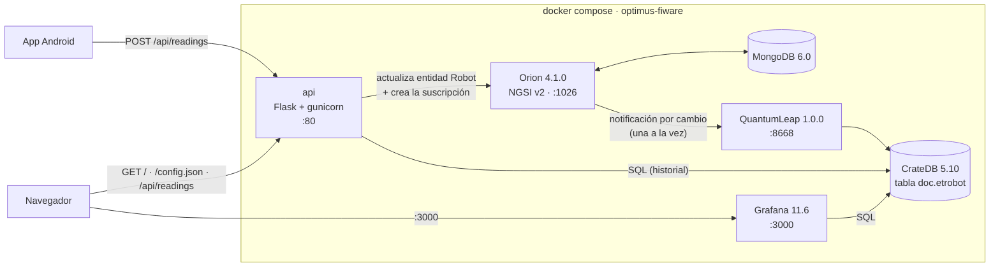

**Modelo de datos.** Cada robot es una entidad NGSI v2 `urn:ngsi-ld:Robot:<device>` de tipo `Robot` con `temperature`, `humidity`, `location` (`geo:point`) y `TimeInstant`. Orion guarda el estado actual; la suscripción Orion → QuantumLeap (que la api crea en la primera subida, con `onlyChangedAttrs`) convierte cada cambio en una fila de CrateDB.

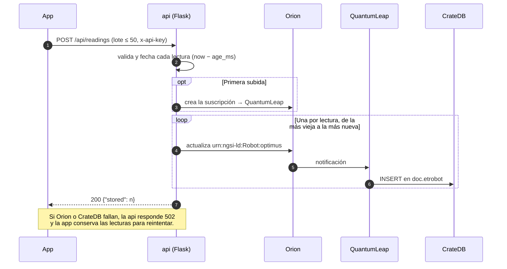

**API del microservicio** (`fiware/api/`):

| Ruta | Método | Función |
|---|---|---|
| `/api/readings` | POST | Sube un lote de lecturas (`readings.py` valida, `orion.py` publica) |
| `/api/readings?sensor=temperature\|humidity\|gps` | GET | Historial desde CrateDB (`history.py`), filtros `from`, `to`, `limit` |
| `/signaling?key=…` | WebSocket | Señalización WebRTC entre robot y dashboard (`signaling.py`) |
| `/config.json` | GET | URLs de la API y de la señalización, y la sala de video, para el dashboard |
| `/` | GET | Dashboard compilado |

Todas las rutas de datos exigen la API key (`x-api-key`, o `?key=` en el WebSocket) y la comparan en tiempo constante. La api corre como **un solo proceso** de gunicorn con 32 hilos, porque las salas de señalización y la marca de "suscripción creada" viven en memoria.

---

## 7. Dashboard web

Aplicación TypeScript (Vite) que la imagen de la api compila y sirve en `/`. Pide la API key una vez y la guarda en el navegador.

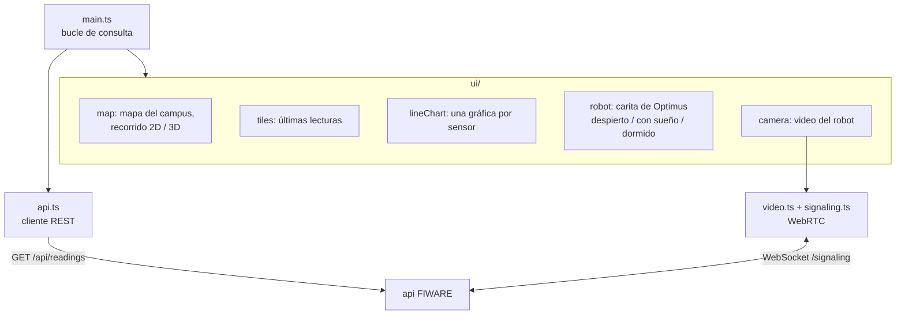

La carita del robot indica el estado de los datos: despierta si llegan datos recientes, con sueño si están viejos y dormida si la API no responde.

---

## 8. Streaming de video (WebRTC)

OpenBot ya sabe transmitir su cámara por WebRTC; solo necesita un servidor que ponga en contacto al celular con el navegador. La api cumple ese papel: reenvía los mensajes de señalización entre los dos miembros de una sala (por defecto `OPTIMUS`). **El video no pasa por el servidor**: va directo del celular al navegador.

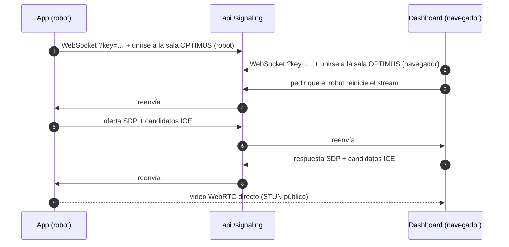

Para que el seguimiento de personas y el stream funcionen a la vez, la app comparte la cámara (`SharedCameraCapturer`): Android solo permite un cliente por cámara, así que la pantalla que la tiene abierta le pasa cada frame al stream (máx. 640 px y 15 fps) con las cajas de detección dibujadas encima.

Limitación conocida: solo se usa un servidor STUN público. Si la red del campus o el operador móvil bloquean la conexión directa, haría falta un relé TURN.

---

## 9. Mecanismos de seguridad

| Riesgo | Mecanismo | Dónde |
|---|---|---|
| Se desconecta el cable o la app se cuelga | Heartbeat: si no llega `h` a tiempo, objetivos = 0 | `lib/heartbeat`, `main.cpp` |
| Cambios bruscos de velocidad o de sentido | Rampa de 170/s y pausa de 500 ms en cero antes de invertir (un giro completo de sentido tarda ~3,5 s) | `lib/ramp` |
| Un flujo de datos serial retrasa el loop | Máximo 64 bytes leídos por ciclo | `openbot_config.h` |
| Líneas seriales corruptas o demasiado largas | El parser descarta líneas de más de 32 caracteres y mensajes desconocidos | `lib/openbot` |
| Motores que se mueven al arrancar | GPIO 2 arranca en bajo; `setup()` pone los motores en 0 | `motors_config.h`, `main.cpp` |
| ECHO de 5 V dañando el ESP32 | Divisor de tensión hacia GPIO 39 | Cableado |
| Acceso no autorizado a la nube | API key en REST y en el handshake del WebSocket; bases de datos solo en localhost | `fiware/api/app.py`, `docker-compose.yml` |

`test/test_safety` envía miles de comandos aleatorios a la rampa y comprueba que la salida nunca da saltos y siempre descansa en cero antes de invertir.

---

## 10. Despliegue y pruebas

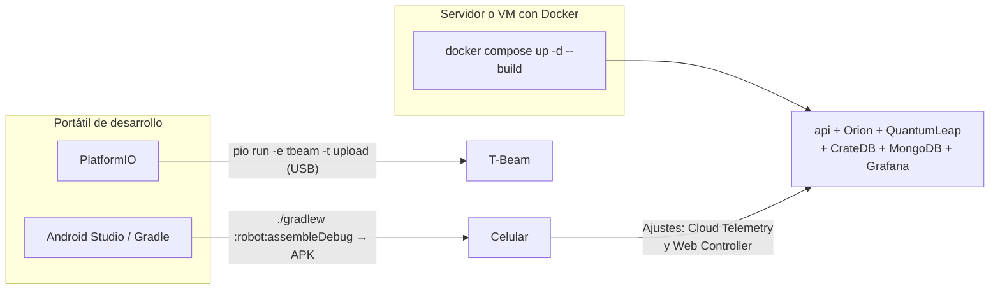

```sh
# Firmware
pio run -e tbeam -t upload          # flashear el firmware OpenBot
pio test -e native                  # tests de las librerías en el PC

# Backend y dashboard
cd fiware && cp .env.example .env   # definir API_KEY
docker compose up -d --build        # http://<host>/ y Grafana en :3000
python -m pytest fiware/api         # tests del microservicio
cd dashboard && npm test            # tests del dashboard

# App
cd android && ./gradlew :robot:assembleDebug
```

Configuración del celular: en *Cloud Telemetry*, URL `http://<host>/api/readings` y la API key; en *Settings → Web Controller*, sala `OPTIMUS` y servidor `ws://<host>/signaling?key=<API_KEY>`. La app usa el mismo `applicationId` que OpenBot de la Play Store, así que hay que desinstalar esa primero.

| Componente | Pruebas |
|---|---|
| Firmware | Unity en `test/`: `drive`, `hdc1080`, `heartbeat`, `openbot`, `ramp`, `safety`, `sonar`, `telemetry` |
| App | JUnit: `VehicleTest`, `Telemetry*Test`, `CameraFragmentTest`, entre otras |
| Microservicio | pytest: app, lecturas, Orion, historial, señalización |
| Dashboard | Vitest: api, geo, formato, gráfica, robot, señalización |

---

## 11. Estructura del repositorio

```
optimus/
├── platformio.ini            # entornos tbeam, tbeam_keyboard y native
├── include/config/           # pines y constantes del firmware
├── lib/                      # lógica portable: drive, hdc1080, heartbeat, motor, openbot, ramp, sonar, telemetry
├── src/
│   ├── openbot/main.cpp      # firmware de producción (app OpenBot)
│   └── keyboard/main.cpp     # firmware de banco (teclado)
├── test/                     # tests Unity del firmware
├── android/                  # app OpenBot modificada (ver UPSTREAM.md)
├── fiware/                   # docker-compose, microservicio Flask y Grafana
├── dashboard/                # dashboard web (TypeScript + Vite)
└── docs/
    ├── ARCHITECTURE.md       # este documento
    ├── hardware-components.md
    ├── datasheets/
    ├── cad/phone_mount/      # soporte del celular para impresión 3D
    ├── media/                # demo en video / GIF
    └── superpowers/          # diseño y plan de la migración al T-Beam
```
